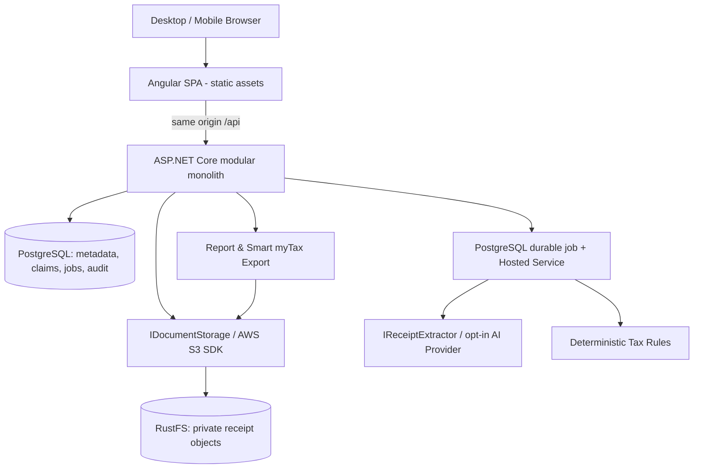

# KuTax — Product & Engineering Handoff for Codex

**Version:** 1.0 · **Prepared:** 10 October 2026 · **Status:** Implementation baseline / proposed decisions clearly marked

> **Mission:** Build a private-first Australian AI-assisted tax-record and deduction-preparation application. Make receipt capture effortless all year, review only exceptions, and generate a beautifully clear and traceable tax-preparation package that makes completing ATO myTax as easy as possible. Start with personal use; retain an achievable path to a compliant commercial product.

## 0. How Codex must use this document

This is the consolidated context and working specification for the **existing locally cloned Git repository named `kutax`**. It supersedes contradictory details in older KuTax plans, especially filesystem-first storage, Blazor, Next.js, and a CSV-only annual export. **Do not overwrite existing repository work blindly.** Inspect the repo first, identify any existing `AGENTS.md`, code, migrations, CI and documents, and explain conflicts before proposing changes. Treat implementation sequencing as tickets, not permission to write the entire application at once.

**Codex execution instructions:**
1. Read this file fully, then inspect the current repository and existing plans/ADRs.
2. Produce a concise gap assessment and suggest documentation updates needed to make older files consistent.
3. Implement **M0 foundation only** unless explicitly asked to proceed. Make small, reviewable changes; update checklists.
4. For each ticket: state file-change plan, implement code + tests + migrations where relevant, run available checks, report gaps/risks, and propose the next ticket.
5. Never assume integration with official ATO submission APIs, undocumented import formats, or auto-approval of tax claims.

## 1. Confirmed user decisions and requirements

| Area | Decision |
|---|---|
| Product name | **KuTax**; repo `kutax` already created and cloned locally |
| Strategy | First solve owner's own annual tax preparation; later consider beta and commercial SaaS |
| Main experience | Save receipts throughout the year, minimise manual data entry, annual one-action **prepare** (not lodge) flow |
| Frontend | **Angular SPA + TypeScript** (explicitly chosen instead of Blazor/Next.js) |
| Backend | **ASP.NET Core / C#**, compact **modular monolith** |
| Database | **PostgreSQL + EF Core** |
| Versions | **Latest stable** frameworks, packages, tools and service releases; exclude previews/RCs/nightlies, pin verified versions, and document compatibility exceptions in `DEPENDENCIES.md` |
| Object storage | **RustFS**, S3-compatible, from the beginning; **not MinIO** or local-filesystem-first |
| Development | Local-first, preferably Docker Compose for dependencies; production deployable without major redesign |
| Deployment | Build Angular to static assets served by the .NET app in production: **one app Docker image** + PostgreSQL + RustFS |
| Repository/hand-off | Detailed written specification that Codex can continue implementing |
| MVP receipt input | Single and multi-file drag/drop; bulk **recursive folder import** including subfolders; mobile browser capture |
| Import automation | AI extraction/classification, deduplication, exception-focused review; avoid compulsory manual categorisation for every receipt |
| ATO integration | No direct filing in MVP. Provide a highly convenient **guided myTax entry** experience and downloadable exports |
| Reporting | Extremely clear, easy-to-read annual summary, detailed figures, clear exceptions, evidence traceability, polished export documents |

**Non-negotiable product principle:** Document understanding by AI and deductible-amount calculation are different trust zones. AI suggests; verified deterministic rules calculate; user reviews; official myTax submission occurs outside KuTax.

## 2. Product vision and customer journey

**Tagline (working):** *Collect continuously. Review intelligently. Prepare confidently.*

**Primary user (MVP):** Australian resident individual with PAYG employment income and common work-related expense records. Financial years run from **1 July through 30 June**, e.g., FY 2025–26 = 1 July 2025 to 30 June 2026. Support importing past records and selecting multiple financial years from day one.

### The intended experience
1. Open KuTax on desktop or mobile.
2. Drag in one or many receipts, **choose an entire existing receipt folder recursively**, or take a photo on mobile.
3. KuTax displays upload progress, stores original files privately in RustFS, and queues processing. User can leave the page.
4. AI extracts merchant, transaction date, total, GST where shown, currency, line items where practical, and candidate expense type. Preserve extracted values with provenance and confidence.
5. KuTax detects exact duplicate documents, warns about likely duplicate transactions, and asks **targeted questions only when necessary**: work purpose, work-use %, reimbursement, mixed-use allocation, supporting evidence, etc.
6. The user reviews exceptions and explicitly approves eligible claims; no model-proposed tax amount is silently approved.
7. At tax time, the user chooses financial year → **Validate → Review issues → Approve snapshot → Prepare Export**.
8. KuTax shows clear category-by-category myTax entry information, with **one-click copy of values**, progress tracking, and a professional annual report plus detailed workbook and evidence archive.
9. User opens official ATO myTax, verifies prefilled information, and **personally files**; KuTax never claims it has lodged the return.

### Key success outcome
User should not need to hunt through receipts, manually re-add totals, or reopen every document to complete relevant myTax deduction sections. Unresolved and excluded items must remain clearly visible without contaminating approved totals.

## 3. MVP scope / exclusions

### Required MVP features
- Sign-in and access-controlled personal account; responsive Angular UI.
- Universal Receipt Inbox; single/multi upload; drag/drop; **recursive directory-tree import** with dry-run preview and progress; mobile camera capture via browser where supported.
- Accept PDF, JPG/JPEG, PNG initially; HEIC only if reliably supported/converted; display unsupported-file feedback. ZIP import optional after security review, not assumed required.
- Secure RustFS object storage, authenticated download/preview, server-side integrity metadata.
- SHA-256 exact duplicate detection per user; optional fuzzy duplicate transaction warning (never silently discard distinct legitimate transactions).
- Resilient asynchronous processing (PostgreSQL-backed durable work items + ASP.NET Core Hosted Service initially).
- Configurable AI extractor; JSON-schema validation; field-level provenance, confidences, prompt/model version; review and correction UI.
- Structured transactions, expenses/allocations, work-use percentages, reimbursements, evidence, notes, and status histories.
- Verified, financial-year-versioned ATO tax rules with deterministic calculations for **small explicitly approved initial coverage**; out-of-scope cases flagged.
- **Smart Tax Export**: year-specific validation, myTax field/category mapping, interactive copy-friendly entry guide, annual summary PDF, detailed `.xlsx`, evidence ZIP and export history.
- Auditable immutable/snapshotted export totals, financial reconciliation, clear disclaimers and unresolved-item handling.
- Build/test pipeline, reproducible local setup, basic backup and restore verification.

### Intentionally not in MVP
- Direct ATO API lodgment, myGov credential collection, browser automation or scraping of myTax, automatic submission or refund guarantees.
- Unofficial reverse-engineered ATO/myDeductions import file generation; only consider a **documented, authorised, tested** integration later.
- Whole-of-return tax liability/refund calculations, sole-trader/BAS/GST accounting, rental properties, capital gains, trusts, complex foreign income, and full commercial tax advice coverage.
- Bank transaction feeds, automatic email inbox access, mail forwarding service, continuous filesystem watcher, native apps, payments/subscriptions, public multi-tenant onboarding.

### Future ingestion channels
1. Receipt-forwarding email address; signed authenticated inbound processing.
2. Optional Gmail/Outlook connection using least-privilege user consent and secure token storage.
3. Mobile Share Target (where supported).
4. Optional desktop directory watcher/sync tool **only if users demand it**; selecting a folder in the browser is a one-time permission-scoped operation, not continuous sync.

## 4. Architecture — compact and portable



### Deployment
- **Local:** Angular dev server (proxy `/api` to ASP.NET Core); ASP.NET Core locally or in container; PostgreSQL + RustFS in Docker Compose with durable volumes and development-only credentials.
- **Production:** multi-stage build compiles Angular; ASP.NET Core serves SPA static files and `/api` from **one app image**. PostgreSQL and RustFS as separate persistent data services (containers or managed equivalents). Use host-provided reverse proxy/TLS, backup, telemetry.
- No Node runtime needed in production for Angular SPA. No microservices, broker, Kubernetes, Supabase, Vercel or special provider APIs by default.
- RustFS is a **service** using persisted local disk/volume; app only uses its S3 endpoint. Do **not** mount user workstation folders into application logic or expose RustFS objects publicly.
- Cloud portability is **configuration + tested data copy**, not magical zero-work migration. Keep vendor SDKs outside Core and maintain a migration/checksum strategy.

### Suggested repository layout

```text
kutax/
  AGENTS.md                        # concise Codex rules referencing docs/architecture/KUTAX_HANDOFF.md
  frontend/                        # Angular SPA
  backend/
    KuTax.Api/                     # ASP.NET Core host, modules, endpoints, job runner
    KuTax.Core/                    # domain + ports; no infrastructure dependencies
    KuTax.Infrastructure/          # EF Core, RustFS S3 adapter, AI adapters, exports
    tests/                         # unit, API, integration, storage contract tests
    KuTax.sln
  infra/
    compose.yaml                   # postgres + RustFS, durable named volumes
    Dockerfile                     # Angular + .NET -> one production image
  docs/
    architecture/                 # KUTAX_HANDOFF.md baseline + IMPLEMENTATION.md progress
    adr/                           # architectural decision records
    tax-rules/                     # versioned, cited verified tax assumptions
  .github/workflows/               # build/test
```

Prefer these three backend projects only initially. Organise **vertically by feature** within them rather than implementing generic repositories/services for everything.

### Core interfaces (conceptual)

```csharp
public interface IDocumentStorage
{
    Task PutAsync(string objectKey, Stream content, string contentType, CancellationToken ct);
    Task<Stream> OpenReadAsync(string objectKey, CancellationToken ct);
    Task<bool> ExistsAsync(string objectKey, CancellationToken ct);
    Task DeleteAsync(string objectKey, CancellationToken ct);
}

public interface IReceiptExtractor
{
    Task<ReceiptExtractionResult> ExtractAsync(DocumentReference document, CancellationToken ct);
}

public interface ITaxRuleEngine
{
    Task<TaxAssessmentResult> AssessAsync(TaxAssessmentRequest request, CancellationToken ct);
}
```

Define `IAnnualReportGenerator`, `IMyTaxCategoryMapper` and/or `ITaxExportFormatter` when implementing reporting; avoid unnecessary abstraction layers beforehand. Use AWS SDK for .NET S3 adapter against private RustFS bucket with endpoint/path-style addressing as needed; verify compatibility via contract tests. Object keys are opaque identifiers, never original filenames or personally identifying paths.

### Background processing
Use a PostgreSQL-backed durable queue/table, worker leasing/claiming, bounded concurrency, per-job attempts and retry delay, failed/dead-letter state, and idempotent operations. The initial in-process Hosted Service must handle process crashes/restarts. This architecture assumes a **single app replica** initially; add distributed-safe leasing if scale-out becomes necessary.

## 5. Receipt ingestion, including existing folders

### Input UX
- Main Receipt Inbox displays prominent drag/drop zone, “Choose files”, **“Import folder”**, mobile “Take photo”, active processing and review statuses.
- Folder selection from Angular/browser via `webkitdirectory` where supported. Read `File.webkitRelativePath`; this is descriptive source metadata **only**, never a trusted filesystem path. Feature-detect and supply file-by-file fallback for unsupported browsers.
- Import preview lists folder tree, file counts, supported/unsupported files, total bytes, potential duplicates, optional financial-year hints.
- Upload concurrency and size limits configurable; show per-file and batch progress, cancellation, retry, completed/skipped/failed summary.
- The user can reselect **the same folder later** and KuTax recognises exact duplicates by checksum, importing only new files as new document records. Browser cannot monitor the local folder silently.
- Preserve `original_filename`, `source_relative_path`, import batch ID and upload time; path may inform AI classification but **never establishes tax eligibility or determines FY**. FY comes from reviewed transaction dates, with ambiguity flagged.

### Upload and processing states
`Discovered → Uploading → Stored → Queued → Extracting → Extracted → NeedsReview → Reviewed` with `Duplicate`, `Unsupported`, `Failed`, `Excluded` exceptions as appropriate. Keep **document ingestion states** distinct from **tax claim states** (`Candidate`, `NeedsEvidence`, `Approved`, `Excluded`).

### Secure upload workflow
1. Authenticated upload initiation; server verifies ownership and file limits/type, and uses server-issued opaque keys.
2. Stream content (avoid whole-file RAM buffering); inspect signatures, calculate SHA-256; quarantine/scan according to documented risk policy; never trust extensions or client-supplied MIME alone.
3. Put private object in RustFS; persist document metadata, checksum, source path and durable extraction job in PostgreSQL; handle partial DB/object failure with cleanup/reconciliation.
4. Return `documentId` and status; Angular polls or uses suitable push mechanism; users need not keep upload screen open while server-side processing continues.
5. AI processing produces **candidate** fields, not approved claims. Preserve source bytes unchanged and store model output separately from confirmed fields.
6. Exact duplicate scope is per owner/tenant. When a receipt is relevant to more than one allocation, link rather than deleting it. Fuzzy matching only warns.

### Privacy of import paths
Absolute client filesystem paths are never required. Normalize relative paths; reject traversal sequences and malicious filenames. Never log receipt content or personal directory names unnecessarily.

## 6. Data model and invariants

| Entity | Purpose / illustrative fields |
|---|---|
| User / Tenant | owner id, identity; retain tenant boundary design for beta |
| FinancialYear | FY label, start/end, jurisdiction, ruleset version |
| ImportBatch | owner, started/finished, source kind, counts, status |
| Document | owner, opaque storage key, original name, relative path, SHA-256, type, size, created, import batch, status |
| ExtractionRun | document id, model/prompt/schema version, raw structured response (secured), confidence/provenance, timestamp, status |
| Transaction | merchant, date, total, GST if observed, currency, user-confirmed fact version |
| ExpenseAllocation | transaction, expense category, amount, work-use %, reimbursement flags, narrative |
| EvidenceLink | many-to-many links from records/claims to documents and supporting evidence |
| TaxRule | jurisdiction, FY, effective date, source URL, version, reviewed status, method and evidence conditions |
| TaxClaim | FY, category, evaluated deductible amount, status, rule version, evidence, review actor/time |
| ProcessingJob | type, object reference, state, attempts, lease/next run, errors (sanitised) |
| ExportSnapshot | FY, approval actor/time, mapping/rule version, frozen claim IDs/amounts, checksums, generated files |
| AuditEvent | actor, action, target, timestamp, before/after reference and reason (no secrets) |

**Invariants:**
- Keep `Document` separate from `Transaction` and `TaxClaim`. One receipt can contain several allocated expenses; one claim can require multiple supporting records.
- `Expense amount` ≠ `Deductible amount` ≠ `Tax saving/refund`.
- Monetary arithmetic in C# uses `decimal`, explicit rounding policy, and input/output reconciliation; never floating-point for money.
- Distinguish transaction date from upload date; FY is based on applicable tax rules and recorded event dates, not folder name.
- AI output does not overwrite user-confirmed facts without a visible proposed correction.
- No approved claim without traceable source evidence and/or documented eligible substantiation method, sourced rule and approval history.
- Export snapshots are immutable and reproducible; later edits require a new snapshot/version.
- Rule changes are effective by financial year and require sources, review, regression tests.

## 7. AI extraction, review and rules

### AI may
- Parse scanned/image/PDF receipt text and normalize structured fields.
- Suggest merchant, amount, date, line items, GST if explicitly shown, category and follow-up questions.
- Identify uncertainty, potential duplicate records and missing supporting facts.

### AI must not
- Invent expense amounts or missing dates; approve deductibility based solely on confidence.
- Use generic language-model knowledge as the authoritative tax calculator.
- Promise tax refunds, file returns, or submit credentials to myGov.

### Workflow
`Document → Extraction candidate → User-confirmed transaction → Allocation → FY-verified tax rule assessment → Candidate claim → Human review/approval → Export snapshot`.

### Guardrails
- Structured schema validation; reject malformed fields, negative/implausible values, ambiguous dates, or inconsistent totals.
- Field-level confidence and evidence/provenance, source original available beside editable result.
- AI provider opt-in, privacy notice, region and retention review, redaction where appropriate, no model training on uploaded data without user's explicit arrangement.
- Start with synthetic fixtures and configurable mock extractor to develop without processing real receipts.
- Tested deterministic rules may handle a limited selection of common categories only. Unsupported claims remain unassessed/flagged.

## 8. Smart Tax Export — mandatory MVP differentiator

### ATO reality / design constraint
KuTax does **not** assume that ATO myTax offers a universal third-party upload of CSV/XLSX/PDF/ZIP or that KuTax can directly lodge a return. An ATO **myDeductions → myTax** internal transfer workflow is not a documented general third-party interface. Verify current ATO guidance before any integration or field mapping; **never reverse-engineer unsupported filing formats as a production feature**.

### Export design
An interactive **myTax Entry Assistant** is the primary friction-reduction experience:
- FY-specific myTax section/category labels and verified codes only; each section has approved total, clear explanation, one-click **Copy amount**, and a progress state (`Not started`, `Entered`, `Checked`).
- Show a compact explanation of what was included, exclusions, special methods and evidence references.
- Show an **exceptions panel** for missing evidence, pending categories, non-mappable claims, or unverified tax rules; do not silently hide unresolved amounts.
- Distinguish KuTax's manually prepared amounts from ATO's own prefill; warn that double entry is possible, so user must reconcile in official myTax.
- Explicit final action: **Prepare tax package**, not “Lodge with ATO” or “Submit tax return”.

Generate from **one approved server-side reporting snapshot / reporting model**:

1. **`Annual_Tax_Summary_FYxxxx-xx.pdf`** — professional executive summary, approved/possible/excluded/pending totals, financial year, record count, coverage limitations, charts only when they improve clarity, category table, actionable exceptions, version/date, concise glossary and disclaimer.
2. **`myTax_Entry_Guide_FYxxxx-xx.pdf`** — verified FY-specific myTax categories/codes, copy-ready rounded entry values, methods, concise manual-entry instructions, reconciliations and warnings; no pretence it can be uploaded into myTax.
3. **`Detailed_Deductions_FYxxxx-xx.xlsx`** — filterable granular rows: merchant, date, invoice amount, work-use %, reimbursed, candidate/approved deductible amount, reason, rule/source, evidence ID, review status. Useful for user or tax agent.
4. **`Evidence_Package_FYxxxx-xx.zip`** — original receipts and other substantiation, defensively named/organised with `manifest.csv` or `manifest.json` (IDs, SHA-256, linked claim/category). Private access; download only after authorization.

Optionally include CSV/JSON machine-readable exports for data portability; avoid relying on XLSX as an ATO import format. Keep huge archives streamed or built in bounded background jobs and stored back to RustFS privately.

### Report UX quality bar
- Readable report without developer expertise: executive summary on first page, plain English and Australian date/currency conventions.
- Approved totals separated visually and numerically from candidate/unreviewed/excluded amounts.
- Right-aligned currency values, consistent decimals/rounding, legible fonts, accessible colour contrast, sensible pagination and print-friendly tables.
- Every figure traceable to claim → calculation → rule version and source → evidence/document; links and IDs in workbook and manifest.
- All PDF, XLSX, UI and myTax guide category totals reconcile **exactly** to the same signed-off snapshot; tested.
- Any uncertain myTax field mapping cannot be exported as a confirmed official code without review.
- Show audit history: who approved, when, export version and regeneration date. Never label a report as a lodged return.

### Minimum export acceptance example
Given a reviewed FY with multiple documents, expenses and allocations, the user can see proposed totals by verified myTax section, copy figures individually, download the four artefacts, trace every included amount, and see unresolved items distinctly. Cross-format sums must match; missing or unverified claim categories are flagged; no filing is attempted.

## 9. UX / screens

1. **Dashboard:** FY switcher, receipt counts, candidate/approved deduction totals, processing queue, exceptions, shortcut to import or export.
2. **Receipt Inbox:** drag/drop; file picker; **Import folder**; camera capture; import preview; row progress; batch summaries; statuses and retry.
3. **Receipt Detail / Review:** original preview next to extracted fields; edit, confirm, category, work-use/reimbursement, trace AI changes.
4. **Expenses & Claims:** filter by FY/category/status; drill down to evidence; bulk-review where safe; show tax-rule context.
5. **Annual Tax Report:** executive summary plus drill-down; visual distinction between reviewed/unreviewed/unsupported; no misleading refund estimate.
6. **myTax Entry Assistant:** each myTax section, copy values, mark entered/checked, warnings for prefill/double-counting and unmapped items.
7. **Exports:** validation, approval, frozen snapshot, downloadable files and export history.
8. **Settings:** AI consent/provider, document privacy, retention/export/backup (advanced settings progressively disclosed).

Accessibility/responsive design is required; keyboard and screen reader usable controls, descriptive error messages, mobile capture flow. Use Australian English in product UI initially.

## 10. API outline (illustrative; refine in implementation)

| Endpoint | Purpose |
|---|---|
| `POST /api/import-batches` | Start import batch with optional source/folder metadata |
| `POST /api/documents` | Upload document, optionally attach import batch and relative path |
| `GET /api/import-batches/{id}` | Progress/counts and failures |
| `GET /api/documents` / `GET /api/documents/{id}` | List/get metadata, extraction/review status |
| `GET /api/documents/{id}/content` | Authenticated private preview/download |
| `POST /api/documents/{id}/retry` | Requeue failed extraction safely |
| `PUT /api/transactions/{id}` | Human corrections/confirmation (with concurrency token) |
| `GET /api/tax-years/{fy}/claims` | Approved, candidate and excluded claims |
| `GET /api/tax-years/{fy}/export-preview` | Display report snapshot preview and mapping warnings |
| `POST /api/tax-years/{fy}/validate-export` | All eligibility/mapping/evidence/reconciliation checks |
| `POST /api/tax-years/{fy}/exports` | Approve & create immutable export snapshot |
| `GET /api/tax-exports/{id}` | Job/status/summary |
| `GET /api/tax-exports/{id}/download` | Authorised package download |

Use same-origin session cookies if suitable; CSRF controls on mutating endpoints, least-privilege RBAC and resource ownership enforcement, typed problem responses, request bounds and rate limiting. Do not expose RustFS credentials to frontend.

## 11. Delivery milestones and acceptance gates

> Timeline is **not** a promise. Work sequentially as small vertical slices; complete each gate before expanding scope.

### M0 — Foundation
- [x] Inspect existing `kutax` repo and reconcile old docs/ADRs to this baseline.
- [x] Angular SPA + ASP.NET Core 10 LTS solution + Core/Infrastructure, same-origin `/api`, smoke UI/API.
- [x] Compose: PostgreSQL and RustFS with persistent volumes, localhost-only dev service ports and no committed credentials.
- [x] EF Core migrations, developer seed using synthetic data only.
- [x] Identity/authentication and ownership enforcement; production Docker image serving Angular static assets.
- [x] CI build/test, README local quick start (workflow implemented; hosted execution pending).

**Gate:** Fresh clone follows documented startup; authenticated shell loads; DB migration works; RustFS health/basic connectivity verified; tests green.

Implementation and verification status is tracked in [IMPLEMENTATION.md](IMPLEMENTATION.md). Local foundation acceptance passed using Podman Compose with fresh service volumes and the built application image; a separate fresh-clone/hosted CI run remains unverified.

### M1 — Universal Receipt Inbox & Folder Import
- [ ] Document, ImportBatch, object storage interface and RustFS AWS SDK adapter, contract tests.
- [ ] Streaming upload, file validation/quarantine, checksums, object metadata and secure retrieval.
- [ ] Angular single + multiple file drag/drop, **recursive folder import** preserving relative path, preview and progress.
- [ ] Idempotent re-import; duplicate statistics; unsupported-file and failed-upload recovery.
- [ ] Responsive camera capture.

**Gate:** Import nested synthetic folder, confirm tree and counts, skip duplicate re-import, download only as rightful user.

### M2 — Async Receipt Understanding
- [ ] PostgreSQL durable jobs, in-process worker, retries/restart recovery.
- [ ] Mock and real opt-in AI extractor, schema/provenance/confidence.
- [ ] Side-by-side receipt review, field editing, uncertain-value prompts; no AI auto-approval.

**Gate:** Jobs survive restart; invalid AI payload rejected; manual corrections retained.

### M3 — Expenses, Evidence & Audit
- [ ] Transactions/allocations, use %, reimbursement, source links and manual corrections.
- [ ] Duplicate transaction warnings (not silent drops), financial year classification with uncertainty states.
- [ ] User action history and reviewed/candidate state workflow.

**Gate:** One receipt can yield multiple allocations; every reviewed field/claim attributable to source and actor.

### M4 — Tax Rules & Claims
- [ ] Sourced FY-versioned rule catalog; limited approved scenarios only.
- [ ] Pure deterministic calculations and golden unit tests; clear unsupported-case statuses.
- [ ] Candidate claims, evidence readiness checks, explicit approval process.

**Gate:** No invented/unverified rates or unsupported automatic claims; calculations reproducible.

### M5 — Clear Annual Reporting & Smart Tax Export
- [ ] Common `AnnualTaxSnapshot`/report DTO with reconciliation tests.
- [ ] Executive Annual Summary PDF and category drill-down UI.
- [ ] Verified year-specific myTax Entry Assistant with copy-value controls and entry progress.
- [ ] myTax Entry Guide PDF; detailed XLSX; evidence ZIP/manifest with hashes.
- [ ] Review exceptions, approve snapshot, download/export history, regression and readability tests.

**Gate:** User can transfer verified categories into official myTax without manually recomputing receipts; all representations reconcile exactly; excluded/pending visible; no lodgment claims.

### M6 — Security, Operations & Personal Trial
- [ ] Threat model, auth/object access tests, malware/quarantine and AI privacy controls.
- [ ] Backup and **restore drill for both PostgreSQL and RustFS**, secure secrets, TLS/config checks.
- [ ] Real receipts only after privacy and consent configuration reviewed; evaluate manual vs AI accuracy on synthetic/permissioned samples.
- [ ] End-to-end personal pilot; accessibility and report readability audit.

**Gate:** Repeatable recovery, all critical risks controlled/documented, user can complete a real-world annual preparation flow.

### Later phases (not MVP blockers)
- Email forwarding and opt-in Gmail/Outlook, mobile share target.
- Multi-tenant RLS/tenant isolation strategy (in SQL/app), billing, support, retention/deletion controls.
- Registered tax-agent workflow and collaboration; assess tax-agent-service/TPB obligations before offering commercial personalised tax services.
- Storage move from RustFS to another compatible provider with object-manifest checksum verification, DB migration and cutover/rollback playbook.
- Official ATO integration **only if an authorised and supported route becomes available**.

## 12. Security, privacy and compliance baseline

- Treat tax receipts as sensitive personal-financial data. Private RustFS bucket, server-controlled opaque keys, no public unauthenticated URLs; strictly scoped permissions.
- Defence in depth: authentication, server-side ownership, upload content/size validation, malware strategy, encryption in transit and at rest, CSRF where cookie-based, audit logs without sensitive payloads.
- No secrets, TFNs, passwords, personal financial records or raw prompts with private data in Git, issue descriptions or CI logs.
- AI provider processing must be opt-in and subject to data locality, retention, training and privacy assessment. Mock extraction usable without external network service.
- Backup **PostgreSQL + RustFS** consistently, including export snapshots and evidence link integrity; test restorability, not just backup existence.
- Do not claim complete tax coverage; maintain FY-specific official guidance references, revision approvals and tested rules. Users remain responsible for confirming information and submitting through official channels.
- Commercial launch needs professional review of TPB tax-agent-service rules, Privacy Act/APP applicability, ATO/software requirements, terms, professional liability and security governance.

## 13. Architecture decisions: lock vs open

**Locked:** Angular; ASP.NET Core modular monolith; PostgreSQL EF Core; RustFS from MVP; S3 storage abstraction; Docker/portability; AI suggestions + deterministic reviewed tax rules; recursive folder import; Smart Tax Export; no direct ATO lodgment.

**To decide in implementation (do not block M0 unnecessarily):** UI component library; report PDF/XLSX libraries and licences; job polling vs SignalR; malware scanning approach; exact file sizes/page limits; supported HEIC conversion; AI provider choice; initial verified tax categories; production host provider; RustFS release/image pin after validation; tax rule editorial sign-off; actual product branding/domain/trademark availability.

Prefer the simplest secure option and write brief ADRs for material selections. Check current official provider/ATO guidance and package licences when implementing, rather than copying unverified facts from an AI conversation.

## 14. Quality metrics / definition of done

- AI extraction target on **100+ synthetic or consented labelled receipts**: merchant, date and amount each ≥95% accuracy, measured separately; uncertain cases are reviewable. Targets, not guarantees.
- 100% of approved exported claim amounts traceable to source record/evidence and reviewed FY rule/assessment.
- Every annual figure reconciles across dashboard, PDFs, XLSX and archive manifest; edge cases tested.
- Idempotent folder re-import, no data loss on retries/restarts, recovery from partially completed uploads.
- Negative auth tests: another user cannot enumerate/download/update a user's tax documents or exports.
- Protected data not leaked into logs, error messages, filenames or unsecured exports.
- Reports legible, easy to scan, printable, mobile UI usable, errors actionable and accessible.
- Migrations and local setup reproducible; unit/integration/contract tests run in CI.

## 15. Initial Codex prompt — copy/paste

> You are taking over the existing `kutax` repository. Read `docs/architecture/KUTAX_HANDOFF.md` in full, plus `AGENTS.md` and existing project documentation. `docs/architecture/KUTAX_HANDOFF.md` is the latest product/architecture baseline; flag contradictions with older docs instead of silently choosing. Inspect the existing repository and give me: (1) a concise current-state/gap assessment, (2) a minimal M0 implementation plan with exact proposed files, (3) any decisions that truly block M0. Implement **only the smallest M0 foundation slice** once you have assessed the repo: Angular frontend, ASP.NET Core modular monolith skeleton, local PostgreSQL/RustFS Compose infrastructure, and basic smoke tests. Maintain one production application image, private RustFS storage, no direct ATO integration, and no tax calculations yet. Run available tests and document how to start locally. Do not overwrite existing work without checking.

---

**Product acceptance north star:** *Drop receipts or import a whole folder → KuTax securely processes and organises them → user reviews exceptions → a single annual preparation action produces a clear, reconciled, traceable, myTax-friendly report and evidence package.*
